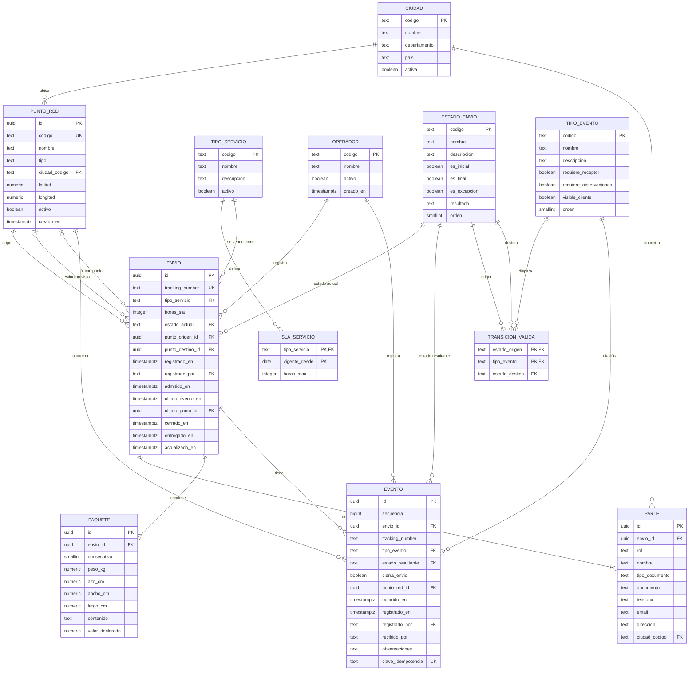

# tracking-logistico-database — Sprint 2

Base de datos del sistema de tracking logístico — Fábrica Escuela, Bases de Datos.
Monolito modular sobre un solo PostgreSQL (Supabase): tres schemas —
`catalogo` (datos de referencia), `envios` (ciclo de vida del envío) y
`eventos` (historial logístico) — y tres roles de base de datos con privilegios
mínimos. Cubre HU-01 a HU-07 (registrar envío, registrar evento, rastreo público,
historial, tiempos de tránsito, envíos retrasados y volumen por punto).

### Integrantes

* Alejandro Botero Arbeláez
* Eyner Gomez Quintero
* Jose Manuel Londoño Castaño
* Ivan Dario López Cuadrado
* Oliver Andres Quiroz Mora
* Juan Daniel Rincon Bedoya

---

## 1. Cambios frente al Sprint 1

El Sprint 1 tenía 2 tablas (`envios.envio`, `eventos.evento`) y un solo usuario
`app_user` con `GRANT ALL`. El Sprint 2 pasa a 12 tablas. Cada cambio responde a
una historia de usuario o a una debilidad que el Sprint 1 dejó anotada.

| # | Cambio | Sprint 1 | Sprint 2 | Motivo |
|---|---|---|---|---|
| 1 | **Entidad nueva `PARTE`** | Columnas `remitente_*` y `destinatario_*` planas en `envio` (8 columnas) | Tabla `envios.parte` 1:N con `envio`, con `rol` ∈ {REMITENTE, DESTINATARIO}, `tipo_documento`, `documento` y `ciudad_codigo` | El Sprint 1 lo dejó escrito: "si esa necesidad aparece en otro sprint, ahí se normaliza". HU-03 verifica al destinatario por teléfono o documento y HU-07 agrupa por ciudad. |
| 2 | **Entidad nueva `PAQUETE`** | No existía | `envios.paquete` 1:N con `envio` (peso, dimensiones, contenido, valor declarado) | Un envío puede tener varios bultos. |
| 3 | **Catálogo `CIUDAD`** | Ciudad no existía | `catalogo.ciudad` (código DIVIPOLA) referenciada por `punto_red` y `parte` | Evitar "Bogotá" / "Bogota" duplicadas al agrupar por ciudad (HU-07). |
| 4 | **Catálogo `PUNTO_RED`** | `evento.punto` era `varchar(150)` libre | `catalogo.punto_red` (centros, puntos de venta, vehículos) y `evento.punto_red_id` FK | Texto libre impedía agrupar por punto y calcular tramos (HU-05, HU-07). |
| 5 | **Catálogos `ESTADO_ENVIO`, `TIPO_EVENTO` y `TRANSICION_VALIDA`** | `CHECK (estado IN (3 valores))` y `CHECK (tipo_evento IN (4 valores))` | Tres tablas: 9 estados, 11 tipos de evento y la máquina de estados como terna (estado origen, tipo de evento, estado destino) | Aparecen excepciones (retención, devolución, extravío, anulación); cambiar las reglas no debe requerir `ALTER TABLE`. |
| 6 | **Catálogos `TIPO_SERVICIO` y `SLA_SERVICIO`** | No existían | `envio.tipo_servicio` FK; `sla_servicio` con vigencia (PK compuesta) | HU-05 y HU-06 comparan el tiempo en red contra el SLA del servicio. |
| 7 | **Catálogo `OPERADOR`** | No existía | `catalogo.operador`; `envio.registrado_por` y `evento.registrado_por` son FK | Trazabilidad de quién registró cada cosa. |
| 8 | **`ENVIO` cambia de llaves y atributos** | PK `bigserial`; `numero_seguimiento`; `estado`; `fecha_registro` | PK `uuid`; `tracking_number` con formato y dígito verificador; `estado_actual` FK; `horas_sla`, `punto_origen_id`, `punto_destino_id`, `registrado_por`, `admitido_en`, `ultimo_evento_en`, `ultimo_punto_id`, `cerrado_en`, `entregado_en`, `actualizado_en` | HU-03 responde estado + último punto + fecha en una sola lectura; el SLA se congela al alta. |
| 9 | **`EVENTO` cambia de llaves y atributos** | `id bigserial`, `envio_id`, `tipo_evento`, `punto`, `fecha_hora`, `receptor` | PK `uuid` + `secuencia` (identity); `estado_resultante`, `cierra_envio`, `ocurrido_en` ≠ `registrado_en`, `registrado_por`, `recibido_por` (antes `receptor`), `observaciones`, `clave_idempotencia`, `tracking_number` | Un lector sin señal reporta horas tarde: el hecho (`ocurrido_en`) se separa de la captura (`registrado_en`). Un reintento no duplica el evento (idempotencia). |
| 10 | **Seguridad** | Un usuario `app_user` con `GRANT ALL`, RLS desactivado | Tres roles (`ms_envios`, `ms_eventos`, `rol_lectura`) con `GRANT` por tabla/vista, RLS activado en las 12 tablas y `REVOKE` al público | Criterio de mínimo privilegio. |
| 11 | **Reglas en la base** | Un `CHECK` (receptor obligatorio en ENTREGADO) | Triggers: transición válida, evento inmutable, SLA congelado, envío completo (2 partes + ≥1 paquete) | La integridad no depende de que cada microservicio la recuerde. |

Las referencias de Sprint 1 que se conservan: `envio` 1:N `evento`, FK directa entre
schemas (monolito), `tracking_number` único, y la regla de que una entrega exige
constancia de quién recibió (ahora declarada como `tipo_evento.requiere_receptor`).

## 2. Modelo entidad-relación refinado



**Cardinalidades.** Un envío tiene exactamente dos partes (remitente y destinatario,
`UNIQUE (envio_id, rol)` + trigger), uno o más paquetes (`UNIQUE (envio_id, consecutivo)`)
y cero o más eventos. `punto_destino_id` y `ultimo_punto_id` son opcionales
(`|o`): un envío recién registrado no ha pasado por ningún punto. `TRANSICION_VALIDA`
resuelve la relación ternaria estado × evento → estado.

---

> **Pendiente (puntos 2 a 6 del Sprint 2):** las secciones siguientes son las del Sprint 1 y describen el modelo anterior de 2 tablas. Se reemplazan al desarrollar modelo físico, consultas, volumen y roles.

## Modelo lógico

**`envios.envio`** (HU-01, HU-03)

| Columna | Tipo | Restricciones |
|---|---|---|
| `id` | bigserial | **PK** |
| `numero_seguimiento` | varchar(30) | **UK**, not null |
| `remitente_nombre` | varchar(150) | not null |
| `remitente_telefono` | varchar(30) | not null |
| `remitente_direccion` | varchar(250) | not null |
| `remitente_email` | varchar(150) | |
| `destinatario_nombre` | varchar(150) | not null |
| `destinatario_telefono` | varchar(30) | not null |
| `destinatario_direccion` | varchar(250) | not null |
| `destinatario_email` | varchar(150) | |
| `estado` | varchar(30) | not null, `CHECK IN ('REGISTRADO','EN_TRANSITO','ENTREGADO')` |
| `fecha_registro` | timestamp | not null, default `now()` |

**`eventos.evento`** (HU-02)

| Columna | Tipo | Restricciones |
|---|---|---|
| `id` | bigserial | **PK** |
| `envio_id` | bigint | **FK →** `envios.envio(id)`, not null |
| `tipo_evento` | varchar(30) | not null, `CHECK IN ('RECOGIDO','EN_TRANSITO','EN_CENTRO_DISTRIBUCION','ENTREGADO')` |
| `punto` | varchar(150) | |
| `fecha_hora` | timestamp | not null, default `now()` |
| `receptor` | varchar(150) | `CHECK`: obligatorio si `tipo_evento = 'ENTREGADO'` |

## Normalización

Las dos tablas cumplen BCNF, no solo 3FN. La diferencia entre ambas formas normales solo importa cuando una tabla tiene dos o más claves candidatas que comparten atributos entre sí — ahí es donde 3FN permite una excepción que BCNF no permite. Acá no pasa eso:

- `envio` tiene dos claves candidatas (`id` y `numero_seguimiento`), pero no comparten ninguna columna, así que no hay excepción que aplicar.
- `evento` solo tiene una clave candidata (`id`), así que el caso ni siquiera se puede dar.

Por eso ambas están en BCNF directamente.

Sobre las columnas `remitente_*` / `destinatario_*` en `envio`: se dejaron planas en vez de sacarlas a una tabla `persona` aparte. No es un problema de normalización — sigue cumpliendo BCNF igual — es que ninguna HU de este sprint pide reutilizar contactos entre envíos distintos. Si esa necesidad aparece en otro sprint, ahí se normaliza.


## Modelo físico

[`schema.sql`](schema.sql) — script único con los tres schemas, las 12 tablas,
roles y RLS, ejecutable de punta a punta contra un proyecto Postgres/Supabase
vacío:

```bash
psql "$DATABASE_URL" -v ON_ERROR_STOP=1 -f schema.sql
```

Los roles son `NOLOGIN`: la contraseña y el `LOGIN` se asignan fuera del repo.

## Estructura del repo

```
.
├── README.md
└── schema.sql
```
