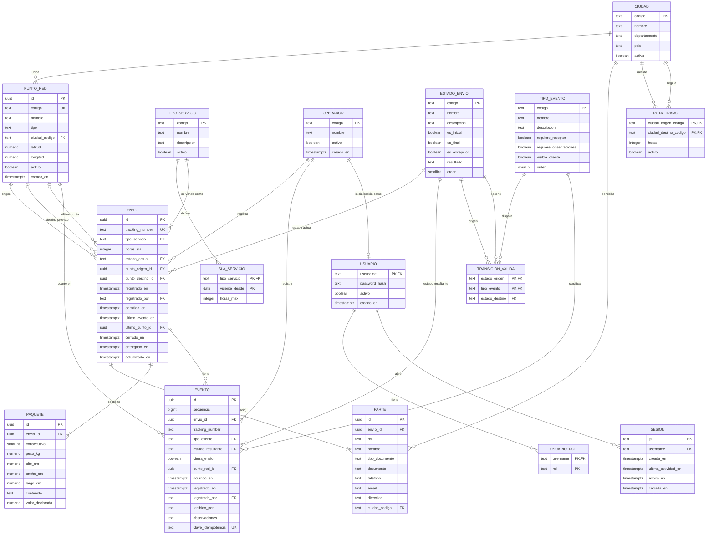

# tracking-logistico-database — Sprint 3

Base de datos del sistema de tracking logístico — Fábrica Escuela, Bases de Datos.
Monolito modular sobre un solo PostgreSQL (Supabase): cuatro schemas —
`catalogo` (datos de referencia y red de rutas), `envios` (ciclo de vida del envío),
`eventos` (historial logístico) y `acceso` (usuarios y sesiones) — y roles de base de
datos con privilegios mínimos. Cubre HU-01 a HU-08 (registrar envío, registrar evento,
rastreo público, historial, tiempos de tránsito, envíos retrasados, volumen por punto e
inicio de sesión).

### Integrantes

* Alejandro Botero Arbeláez
* Eyner Gomez Quintero
* Jose Manuel Londoño Castaño
* Ivan Dario López Cuadrado
* Oliver Andres Quiroz Mora
* Juan Daniel Rincon Bedoya

---

## 1. Cambios respecto al Sprint 2

El Sprint 3 parte del esquema entregado en el Sprint 2 (12 tablas, 3 schemas, 4 roles). Cada
cambio se identifica con un código (`M` modelo, `S` script, `R` roles, `T` triggers, `F` funciones,
`Q` consultas, `P` pruebas) que se repite en la sección donde se detalla. El historial del Sprint 1 al Sprint 2 quedó en el
[anexo](#anexo-cambios-del-sprint-1-al-sprint-2).

### MER

| # | Cambio | Sprint 2 | Sprint 3 | Motivo |
|---|---|---|---|---|
| M1 | **Entidad nueva `RUTA_TRAMO`** | No existía: un hub intermedio podía ser cualquier punto de la red | `catalogo.ruta_tramo` (ciudad origen, ciudad destino, horas, activo), PK compuesta, dos FK a `CIUDAD` | La red de la operación ya no es "cualquier ciudad con cualquier ciudad": un envío Medellín → Bogotá no puede pasar por Barranquilla. Da el tiempo esperado por tramo contra el que se compara `v_tramo` (HU-05). |
| M2 | **Entidad nueva `USUARIO`** | El operador solo existía como `catalogo.operador` (código del token), sin credenciales en la base | `acceso.usuario` 1:1 con `OPERADOR` (`username` es PK y FK), `password_hash` BCrypt, `activo` | HU-08: inicio de sesión propio. Las credenciales vivían en variables de entorno y se comparaban en texto plano. |
| M3 | **Entidad nueva `USUARIO_ROL`** | No existía | `acceso.usuario_rol` (username, rol ∈ {OPERADOR, ADMIN}), PK compuesta | Un usuario puede tener varios roles de aplicación. Guardarlos como lista en una columna rompería 1FN. |
| M4 | **Entidad nueva `SESION`** | No existía | `acceso.sesion` (jti, usuario, creada, última actividad, expira, cerrada), N:1 con `USUARIO` | HU-08: un JWT sigue siendo válido hasta que vence. Con la sesión en la base, cerrar sesión es real y las sesiones inactivas se cierran. |
| M5 | **Schema nuevo `acceso`** | 3 schemas | 4 schemas: `catalogo`, `envios`, `eventos`, `acceso` | Las credenciales quedan aisladas: ningún microservicio de negocio tiene `USAGE` sobre `acceso` (ver R1). |

Lo que **no** cambia y por qué: las 12 entidades del Sprint 2 conservan sus llaves y
relaciones. Los ajustes sobre ellas son restricciones e índices (no cambian el MER) y se
listan en la tabla del script.

### Script (`schema.sql`)

Además de las tablas, llaves, índices y semilla de M1–M5:

| # | Cambio | Sprint 2 | Sprint 3 | Motivo |
|---|---|---|---|---|
| S1 | **Cronología del envío** | El primer evento solo se comparaba con `ultimo_evento_en`, nulo en un envío nuevo: un envío podía quedar admitido antes de registrarse | CHECK `ck_envio_cronologia` (`admitido_en` y `cerrado_en` ≥ `registrado_en`) y la misma validación en `trg_evento_validar` con mensaje claro | Ningún movimiento puede ser anterior al registro. El tiempo de mostrador de HU-05 (`admitido_en − registrado_en`) salía negativo. |
| S2 | **Entrega = cierre** | `ck_envio_cierre`: si hay entrega, hay cierre (sin importar cuándo) | `ck_envio_entrega_es_cierre`: `entregado_en = cerrado_en` | Las dos fechas las escribe el mismo evento. Si difieren, HU-05 y HU-06 miden contra fechas distintas. |
| S3 | **Teléfono con dígitos** | `telefono` solo debía no estar vacío | CHECK de al menos 7 dígitos | `rastrear()` (HU-03) verifica los últimos 4 dígitos. Un teléfono "N/A" dejaba al destinatario sin forma de rastrear. |
| S4 | **Índice sin uso eliminado** | `idx_punto_red_activo (activo) WHERE activo` | Eliminado | Indexaba un booleano casi constante; ninguna consulta ni trigger lo usaba y solo costaba escrituras. |
| S5 | **Índices de las tablas nuevas** | — | `idx_ruta_tramo_destino`, `idx_sesion_usuario`, `idx_sesion_abierta` (parcial) | Cubren las FK que no son prefijo de una PK y el cierre de sesiones vencidas. |

Verificado contra un PostgreSQL 16 vacío: el script corre sin errores, un envío completo
llega a `ENTREGADO`, y los tres casos inválidos (evento anterior al registro, teléfono "N/A",
entrega con fecha distinta del cierre) son rechazados.

### Roles y seguridad

| # | Cambio | Sprint 2 | Sprint 3 | Motivo |
|---|---|---|---|---|
| R1 | **Rol nuevo `ms_acceso`** | 4 roles; nadie gestionaba credenciales | 5 roles. `ms_acceso` es el único servicio con `USAGE` sobre `acceso`, y no tiene `USAGE` sobre ningún otro schema | HU-08. Ningún microservicio de negocio puede leer un hash de contraseña, y un fallo en el login no expone envíos. |
| R2 | **`UPDATE` por columna en `envios`** | `ms_envios` tenía `UPDATE` sobre todas las columnas de `envio`, `parte` y `paquete` | `UPDATE (punto_destino_id)` en `envio`; en `parte` y `paquete` solo los datos corregibles (no `envio_id`, `rol` ni `consecutivo`) | Con el `UPDATE` completo, `ms_envios` podía escribir `estado_actual = 'ENTREGADO'` sin evento ni receptor y saltarse la máquina de estados (HU-02). |
| R3 | **Privilegios sobre las tablas nuevas** | — | `ms_acceso`: `SELECT` en `usuario` y `usuario_rol`, `SELECT, INSERT` + `UPDATE (ultima_actividad_en, cerrada_en)` en `sesion`. `ruta_tramo`: lectura para los dos microservicios, escritura solo `rol_admin` | Mínimo privilegio: el login no crea usuarios ni alarga sesiones, y la red de rutas es una regla del negocio, como las transiciones. |
| R4 | **`EXECUTE` explícito sobre funciones** | Las 16 funciones tenían `EXECUTE` para `PUBLIC` (el permiso por defecto de Postgres), incluidas `rastrear()` y `registrar_operador()` (`SECURITY DEFINER`). `ms_eventos` tenía un `GRANT` inútil sobre `tracking_valido()` | `ALTER DEFAULT PRIVILEGES REVOKE EXECUTE ON FUNCTIONS FROM PUBLIC` + `REVOKE ALL ON ALL FUNCTIONS`. Cada rol recibe `EXECUTE` solo sobre lo que invoca; `rol_admin` sobre todas | Una función abierta a `PUBLIC` solo estaba protegida por no tener `USAGE` sobre el schema. Los procedimientos que se agreguen en adelante nacen cerrados y necesitan `GRANT EXECUTE` explícito. |
| R5 | **RLS en las tablas nuevas** | 12 tablas con RLS | 16 tablas con RLS. `p_ruta_lectura`, `p_usuario_lectura`, `p_usuario_rol_lectura` y tres políticas sobre `sesion` que filtran filas (solo se inserta abierta y solo se actualiza abierta). `p_admin` se extiende a `acceso` | Sin política, una tabla con RLS niega todo; con `USING (cerrada_en IS NULL)` una sesión cerrada no se puede reabrir. |
| R6 | **`verificar_rls()` ampliada** | Revisaba RLS y `GRANT` a `PUBLIC` en tablas de 3 schemas | Revisa 4 schemas y además funciones con `EXECUTE` para `PUBLIC` y funciones `SECURITY DEFINER` sin `search_path` fijo | La comprobación automática cubre los objetos nuevos. Debe devolver cero filas. |

### Triggers, funciones y consultas

| # | Cambio | Sprint 2 | Sprint 3 | Motivo |
|---|---|---|---|---|
| T1 | **Triggers documentados por HU** | Los 7 triggers existían pero el README no los documentaba | Sección [8](#8-triggers): cada uno con su tabla, evento, momento, HU y propósito | Que cada regla de negocio de la base se pueda rastrear hasta la historia de usuario que la pide. |
| T2 | **`trg_evento_validar` ampliado** | Comparaba el primer evento solo con `ultimo_evento_en`, nulo en un envío nuevo | También rechaza un evento anterior a `registrado_en` (ver **S1**) | Ningún movimiento puede ser anterior al registro del envío. |
| F1 | **Funciones documentadas por HU** | Sin sección propia | Sección [9](#9-funciones): parámetros, resultado y ejemplo de llamada de cada una | Que se pueda invocar cada función sin leer el script. Los permisos de `EXECUTE` están en **R4**. |
| F2 | **`verificar_rls()` ampliada** | Revisaba RLS y `GRANT` a `PUBLIC` en tablas de 3 schemas | Cubre 4 schemas y funciones abiertas a `PUBLIC` (ver **R6**) | La verificación automática cubre los objetos nuevos. |
| Q1 | **Consultas: de 15 a 20** | 15 consultas (S1-1 a S2-8, V-1 y V-2) | Se agregan `S3-1` a `S3-4` y `V-3` | Cubren lo nuevo del Sprint 3: rastreo con segundo factor (HU-03), red de rutas (HU-05 y HU-02) y sesiones y usuarios (HU-08). |
| P1 | **`pruebas.sql`** | No existía | Script que prueba cada trigger y cada función con datos de ejemplo y se revierte al final | Evidencia de que los triggers y las funciones se comportan como dice el README. |

## 2. Modelo entidad-relación refinado



Entidades nuevas en el Sprint 3 (ver [cambios M1–M5](#1-cambios-respecto-al-sprint-2)):
`RUTA_TRAMO`, `USUARIO`, `USUARIO_ROL` y `SESION`.

**Cardinalidades.** Un envío tiene exactamente dos partes (remitente y destinatario,
`UNIQUE (envio_id, rol)` + trigger), uno o más paquetes (`UNIQUE (envio_id, consecutivo)`)
y cero o más eventos. `punto_destino_id` y `ultimo_punto_id` son opcionales
(`|o`): un envío recién registrado no ha pasado por ningún punto. `TRANSICION_VALIDA`
resuelve la relación ternaria estado × evento → estado.

`RUTA_TRAMO` es una relación N:M de `CIUDAD` consigo misma con atributos propios
(`horas`, `activo`); el tramo es dirigido, así que A → B y B → A son dos filas. Un
`OPERADOR` tiene a lo sumo un `USUARIO` (`|o`): los operadores que llegan con un token
de otro proveedor de identidad no tienen credenciales aquí. Un `USUARIO` tiene cero o más
roles y cero o más sesiones; un usuario sin rol existe pero no puede operar (el token sale sin `roles`).

---

## 3. Modelo físico

[`schema.sql`](schema.sql) es el script único (cuatro schemas, 16 tablas, índices,
triggers, vistas, RLS y roles), ejecutable de punta a punta contra un proyecto
Postgres/Supabase vacío:

```bash
psql "$DATABASE_URL" -v ON_ERROR_STOP=1 -f schema.sql
```

Lo que sigue documenta las 16 tablas tal como las crea el script. Lo nuevo o
modificado en el Sprint 3 lleva el código del cambio (**S1**, **M1**…). Los roles son
`NOLOGIN`: la contraseña y el `LOGIN` se asignan fuera del repo.

**Convenciones.** `PK` llave primaria, `FK →` llave foránea, `UK` única, `NN` `NOT NULL`.
Toda FK sin `ON DELETE` explícito es `NO ACTION`; las de `parte`, `paquete` y `evento`
hacia `envio` son `ON DELETE RESTRICT`. Nada se borra en cascada.

### Schema `catalogo` (datos de referencia)

**`catalogo.ciudad`**

| Columna | Tipo | Restricciones |
|---|---|---|
| `codigo` | text | **PK** (DIVIPOLA) |
| `nombre` | text | NN |
| `departamento` | text | |
| `pais` | text | NN, DEFAULT `'CO'`, CHECK `length(pais) = 2` |
| `activa` | boolean | NN, DEFAULT `true` |

UK: `(pais, lower(nombre))` (`uq_ciudad_nombre`), evita "Bogotá" / "bogotá" duplicadas.

**`catalogo.estado_envio`**

| Columna | Tipo | Restricciones |
|---|---|---|
| `codigo` | text | **PK** |
| `nombre` | text | NN |
| `descripcion` | text | |
| `es_inicial` | boolean | NN, DEFAULT `false` |
| `es_final` | boolean | NN, DEFAULT `false` |
| `es_excepcion` | boolean | NN, DEFAULT `false` |
| `resultado` | text | CHECK `IN ('EXITOSO','FALLIDO')` |
| `orden` | smallint | |

CHECK de tabla: `NOT (es_inicial AND es_final)`; `(resultado IS NOT NULL) = es_final`
(solo los estados finales llevan resultado); `es_excepcion OR orden IS NOT NULL`
(los estados de excepción no están sobre la barra de progreso). Únicos parciales:
`uq_estado_inicial` (un solo estado inicial) y `uq_estado_orden` (`orden` no se repite).

**`catalogo.tipo_evento`**

| Columna | Tipo | Restricciones |
|---|---|---|
| `codigo` | text | **PK** |
| `nombre` | text | NN |
| `descripcion` | text | |
| `requiere_receptor` | boolean | NN, DEFAULT `false` |
| `requiere_observaciones` | boolean | NN, DEFAULT `false` |
| `visible_cliente` | boolean | NN, DEFAULT `true` |
| `orden` | smallint | NN, DEFAULT `0` |

**`catalogo.tipo_servicio`**

| Columna | Tipo | Restricciones |
|---|---|---|
| `codigo` | text | **PK** |
| `nombre` | text | NN |
| `descripcion` | text | |
| `activo` | boolean | NN, DEFAULT `true` |

**`catalogo.operador`**

| Columna | Tipo | Restricciones |
|---|---|---|
| `codigo` | text | **PK**, CHECK `length(btrim(codigo)) > 0` (claim `sub` del token) |
| `nombre` | text | |
| `activo` | boolean | NN, DEFAULT `true` |
| `creado_en` | timestamptz | NN, DEFAULT `now()` |

**`catalogo.punto_red`**

| Columna | Tipo | Restricciones |
|---|---|---|
| `id` | uuid | **PK**, DEFAULT `gen_random_uuid()` |
| `codigo` | text | **UK**, NN |
| `nombre` | text | NN |
| `tipo` | text | NN, CHECK `IN ('CENTRO_DISTRIBUCION','PUNTO_VENTA','VEHICULO','DESTINO')` |
| `ciudad_codigo` | text | **FK →** `catalogo.ciudad(codigo)`, NN |
| `latitud` | numeric(9,6) | CHECK entre −90 y 90 |
| `longitud` | numeric(9,6) | CHECK entre −180 y 180 |
| `activo` | boolean | NN, DEFAULT `true` |
| `creado_en` | timestamptz | NN, DEFAULT `now()` |

Índice: `idx_punto_red_ciudad (ciudad_codigo)`. **S4:** se eliminó `idx_punto_red_activo`, un
índice sobre un booleano casi siempre `true` que ninguna consulta usaba (el trigger busca el
punto por `id`, que ya tiene PK).

**`catalogo.sla_servicio`**

| Columna | Tipo | Restricciones |
|---|---|---|
| `tipo_servicio` | text | **PK** (1/2), **FK →** `catalogo.tipo_servicio(codigo)` |
| `vigente_desde` | date | **PK** (2/2), DEFAULT `CURRENT_DATE` |
| `horas_max` | integer | NN, CHECK `horas_max > 0` |

**`catalogo.transicion_valida`** (máquina de estados: estado origen × evento → estado destino)

| Columna | Tipo | Restricciones |
|---|---|---|
| `estado_origen` | text | **PK** (1/2), **FK →** `catalogo.estado_envio(codigo)` |
| `tipo_evento` | text | **PK** (2/2), **FK →** `catalogo.tipo_evento(codigo)` |
| `estado_destino` | text | **FK →** `catalogo.estado_envio(codigo)`, NN |

Trigger `trg_transicion_coherente`: el estado inicial no puede ser destino y un
estado final no puede ser origen.

**`catalogo.ruta_tramo`** (**M1**, red de rutas: tramo dirigido entre dos ciudades)

| Columna | Tipo | Restricciones |
|---|---|---|
| `ciudad_origen_codigo` | text | **PK** (1/2), **FK →** `catalogo.ciudad(codigo)` |
| `ciudad_destino_codigo` | text | **PK** (2/2), **FK →** `catalogo.ciudad(codigo)` |
| `horas` | integer | NN, CHECK `horas > 0` |
| `activo` | boolean | NN, DEFAULT `true` (cerrar un tramo sin borrarlo) |

CHECK de tabla `ck_ruta_tramo_distinto`: `ciudad_origen_codigo <> ciudad_destino_codigo`.
Índice: `idx_ruta_tramo_destino (ciudad_destino_codigo)`, para la FK y para buscar qué tramos
llegan a una ciudad (la PK ya cubre los que salen). La semilla trae 10 tramos (5 en cada sentido)
entre las 4 ciudades.

### Schema `envios` (ciclo de vida del envío)

**`envios.envio`** (HU-01, HU-03, HU-05, HU-06)

| Columna | Tipo | Restricciones |
|---|---|---|
| `id` | uuid | **PK**, DEFAULT `gen_random_uuid()` |
| `tracking_number` | text | **UK**, NN, DEFAULT `envios.gen_tracking_number()`, CHECK `envios.tracking_valido(tracking_number)` (formato `FDX` + 12 dígitos, los 2 últimos de verificación) |
| `tipo_servicio` | text | **FK →** `catalogo.tipo_servicio(codigo)`, NN |
| `horas_sla` | integer | NN, CHECK `horas_sla > 0`; lo fija el trigger `trg_envio_sla` desde `sla_servicio` al alta |
| `estado_actual` | text | **FK →** `catalogo.estado_envio(codigo)`, NN, DEFAULT `catalogo.estado_inicial()` |
| `punto_origen_id` | uuid | **FK →** `catalogo.punto_red(id)`, NN |
| `punto_destino_id` | uuid | **FK →** `catalogo.punto_red(id)` |
| `registrado_en` | timestamptz | NN, DEFAULT `now()` |
| `registrado_por` | text | **FK →** `catalogo.operador(codigo)`, NN |
| `admitido_en` | timestamptz | |
| `ultimo_evento_en` | timestamptz | |
| `ultimo_punto_id` | uuid | **FK →** `catalogo.punto_red(id)` |
| `cerrado_en` | timestamptz | |
| `entregado_en` | timestamptz | **S2:** CHECK de tabla `ck_envio_entrega_es_cierre`: `entregado_en IS NULL OR entregado_en = cerrado_en` (reemplaza a `ck_envio_cierre`) |
| `actualizado_en` | timestamptz | NN, DEFAULT `now()`; lo sella `trg_envio_actualizado` en cada `UPDATE` |

Índices: `idx_envio_registrado_en`, `idx_envio_origen (punto_origen_id, registrado_en)`,
`idx_envio_destino`, `idx_envio_estado`, `idx_envio_tipo_servicio`, `idx_envio_operador`,
`idx_envio_ultimo_punto`, `idx_envio_en_red (ultimo_evento_en) WHERE cerrado_en IS NULL`.
Trigger diferido `trg_envio_completo`: al hacer `COMMIT` el envío debe tener 2 partes y ≥ 1 paquete.
**S1:** CHECK de tabla `ck_envio_cronologia`: `admitido_en` y `cerrado_en`, si existen, son
`>= registrado_en` (ningún movimiento antes del registro). `trg_evento_validar` hace la misma
comprobación antes, para devolver un mensaje claro en lugar del nombre de la restricción.

**`envios.parte`** (remitente y destinatario)

| Columna | Tipo | Restricciones |
|---|---|---|
| `id` | uuid | **PK**, DEFAULT `gen_random_uuid()` |
| `envio_id` | uuid | **FK →** `envios.envio(id)` `ON DELETE RESTRICT`, NN |
| `rol` | text | NN, CHECK `IN ('REMITENTE','DESTINATARIO')` |
| `nombre` | text | NN, CHECK `length(btrim(nombre)) > 0` |
| `tipo_documento` | text | CHECK `IN ('CC','CE','NIT','PAS')` |
| `documento` | text | CHECK de tabla: `(tipo_documento IS NULL) = (documento IS NULL)` |
| `telefono` | text | NN, **S3:** CHECK al menos 7 dígitos (`length(regexp_replace(telefono, '\D', '', 'g')) >= 7`) |
| `email` | text | CHECK formato `x@y.z` si no es nulo |
| `direccion` | text | NN, CHECK `length(btrim(direccion)) > 0` |
| `ciudad_codigo` | text | **FK →** `catalogo.ciudad(codigo)`, NN |

UK: `(envio_id, rol)` — un envío no repite remitente ni destinatario. Índices:
`idx_parte_envio`, `idx_parte_ciudad`, `idx_parte_documento (tipo_documento, documento) WHERE documento IS NOT NULL`.

**`envios.paquete`**

| Columna | Tipo | Restricciones |
|---|---|---|
| `id` | uuid | **PK**, DEFAULT `gen_random_uuid()` |
| `envio_id` | uuid | **FK →** `envios.envio(id)` `ON DELETE RESTRICT`, NN |
| `consecutivo` | smallint | NN, CHECK `consecutivo > 0` |
| `peso_kg` | numeric(8,3) | NN, CHECK `peso_kg > 0` |
| `alto_cm` | numeric(7,2) | CHECK `> 0` |
| `ancho_cm` | numeric(7,2) | CHECK `> 0` |
| `largo_cm` | numeric(7,2) | CHECK `> 0` |
| `contenido` | text | NN |
| `valor_declarado` | numeric(14,2) | CHECK `>= 0` |

UK: `(envio_id, consecutivo)`. Índice: `idx_paquete_envio`.

### Schema `eventos` (historial logístico)

**`eventos.evento`** (HU-02, HU-04, HU-05, HU-07)

| Columna | Tipo | Restricciones |
|---|---|---|
| `id` | uuid | **PK**, DEFAULT `gen_random_uuid()` |
| `secuencia` | bigint | NN, `GENERATED ALWAYS AS IDENTITY` (orden de llegada; desempata `ocurrido_en`) |
| `envio_id` | uuid | **FK →** `envios.envio(id)` `ON DELETE RESTRICT`, NN |
| `tracking_number` | text | NN; copia del número del envío, la fija `trg_evento_validar` |
| `tipo_evento` | text | **FK →** `catalogo.tipo_evento(codigo)`, NN |
| `estado_resultante` | text | **FK →** `catalogo.estado_envio(codigo)`, NN; la resuelve `trg_evento_validar` contra `transicion_valida` |
| `cierra_envio` | boolean | NN, DEFAULT `false`; `true` si el estado resultante es final |
| `punto_red_id` | uuid | **FK →** `catalogo.punto_red(id)`, NN |
| `ocurrido_en` | timestamptz | NN, DEFAULT `now()`, CHECK `ocurrido_en <= registrado_en + interval '5 minutes'` |
| `registrado_en` | timestamptz | NN, DEFAULT `now()` |
| `registrado_por` | text | **FK →** `catalogo.operador(codigo)`, NN |
| `recibido_por` | text | obligatorio si `tipo_evento.requiere_receptor` (trigger) |
| `observaciones` | text | obligatorio si `tipo_evento.requiere_observaciones` (trigger) |
| `clave_idempotencia` | text | |

Únicos parciales: `uq_evento_idempotencia (clave_idempotencia) WHERE clave_idempotencia IS NOT NULL`
(un reintento no duplica el evento) y `uq_evento_cierre (envio_id) WHERE cierra_envio`
(un envío se cierra una sola vez). Índices: `idx_evento_envio (envio_id, ocurrido_en DESC, secuencia DESC)`,
`idx_evento_tracking`, `idx_evento_punto (punto_red_id, ocurrido_en)`,
`idx_evento_tipo (tipo_evento, ocurrido_en)`, `idx_evento_operador`, `idx_evento_ocurrido_brin` (BRIN sobre `ocurrido_en`).
Triggers: `trg_evento_validar` (BEFORE INSERT: transición legal, orden cronológico, punto activo, receptor y observaciones),
`trg_evento_aplicar_estado` (AFTER INSERT: actualiza `envio`) y `trg_evento_inmutable` (bloquea `UPDATE` y `DELETE`).

### Schema `acceso` (usuarios y sesiones, HU-08)

**`acceso.usuario`** (**M2**)

| Columna | Tipo | Restricciones |
|---|---|---|
| `username` | text | **PK**, **FK →** `catalogo.operador(codigo)` (el `sub` del token) |
| `password_hash` | text | NN, CHECK formato BCrypt (`$2a$`/`$2b$`/`$2y$` + costo + 53 caracteres) |
| `activo` | boolean | NN, DEFAULT `true` (se desactiva, no se borra) |
| `creado_en` | timestamptz | NN, DEFAULT `now()` |

**`acceso.usuario_rol`** (**M3**)

| Columna | Tipo | Restricciones |
|---|---|---|
| `username` | text | **PK** (1/2), **FK →** `acceso.usuario(username)` `ON DELETE RESTRICT` |
| `rol` | text | **PK** (2/2), CHECK `IN ('OPERADOR','ADMIN')` |

**`acceso.sesion`** (**M4**)

| Columna | Tipo | Restricciones |
|---|---|---|
| `jti` | text | **PK**, CHECK `length(btrim(jti)) > 0` (claim `jti` del token) |
| `username` | text | **FK →** `acceso.usuario(username)` `ON DELETE RESTRICT`, NN |
| `creada_en` | timestamptz | NN, DEFAULT `now()` |
| `ultima_actividad_en` | timestamptz | NN, DEFAULT `now()`, CHECK `>= creada_en` |
| `expira_en` | timestamptz | NN, CHECK `> creada_en` |
| `cerrada_en` | timestamptz | CHECK `IS NULL OR >= creada_en`; nulo = sesión abierta |

Índices: `idx_sesion_usuario (username)` (FK, sesiones de un usuario) e
`idx_sesion_abierta (expira_en) WHERE cerrada_en IS NULL` (el cierre periódico de sesiones
vencidas solo recorre las abiertas).

### Normalización

Quince de las 16 tablas cumplen BCNF: todo determinante es llave candidata. `eventos.evento` queda en 2FN por dos desnormalizaciones deliberadas:

- `tracking_number` depende de `envio_id` y no de la llave `id`: dependencia transitiva, así que `evento` no está en 3FN. Se copia a propósito para que MS-Eventos consulte por número sin cruzar al schema de MS-Envíos. No puede divergir: `trg_evento_validar` la sobrescribe en cada `INSERT` con el valor del envío y el historial es inmutable.
- `cierra_envio` depende de `estado_resultante` (`es_final`). Se guarda para poder declarar el único parcial `uq_evento_cierre` sin cablear el código del evento de entrega. También la fija el trigger.

Otras decisiones que conviene dejar explícitas:

- `envio.horas_sla` y las columnas de caché (`estado_actual`, `ultimo_evento_en`, `ultimo_punto_id`, `admitido_en`, `cerrado_en`, `entregado_en`) repiten información derivable de `sla_servicio` y de `evento`, pero dentro de la relación `envio` ninguna determina a otra: todas dependen solo de `id`, por lo que `envio` cumple BCNF. `horas_sla` es una foto del SLA vigente al alta (cambiar el SLA no debe reescribir el pasado). La caché la mantiene `trg_evento_aplicar_estado` y la vista `eventos.v_envio_incoherente` detecta cualquier deriva.
- `parte` conserva nombre, teléfono y documento por envío, sin tabla `persona`. `documento → nombre` no se declara como dependencia: es la foto de lo que se declaró en ese envío, y ninguna HU pide reutilizar contactos. Si aparece esa necesidad, ahí se normaliza.
- Las cuatro tablas nuevas están en BCNF: en `ruta_tramo` y `sesion` todo atributo depende solo
  de la PK, y `usuario_rol` es toda llave. Los roles van en tabla aparte justamente para no
  guardar una lista ("OPERADOR ADMIN") en una columna, que violaría 1FN.
- Las tablas con dos llaves candidatas (`envio`, `punto_red`, `parte`, `paquete`, `ciudad`) las tienen disjuntas, así que ahí la diferencia entre 3FN y BCNF no aparece.

## 4. Roles y seguridad

El Sprint 1 tenía un solo usuario (`app_user`) con `GRANT ALL` y RLS desactivado. El Sprint 2
separó los roles según lo que hace cada actor y le dio a cada uno solo lo que necesita (mínimo
privilegio). El Sprint 3 parte de esa matriz y la extiende a los objetos nuevos: el schema
`acceso` con sus tres tablas, `ruta_tramo` y las funciones. Lo nuevo o modificado lleva el
código del cambio (**R1**…). La seguridad tiene cuatro capas: **roles + `GRANT`/`REVOKE`**
(ahora también por columna y sobre funciones), **Row Level Security**, **triggers** que
protegen las reglas aunque el rol tenga permiso, y **funciones `SECURITY DEFINER`** para los
casos en que un servicio necesita algo que no se le puede conceder directamente.

### Roles

| Rol | Quién lo usa | Para qué |
|---|---|---|
| `rol_admin` | Personas del equipo (administración de datos) | Mantener los catálogos que definen las reglas (estados, tipos de evento, transiciones, servicios, SLA, **red de rutas**), **crear y desactivar usuarios** y corregir datos |
| `ms_envios` | **La aplicación**: microservicio MS-Envíos | Registrar envíos, partes y paquetes (HU-01), rastreo público (HU-03), alta de puntos y ciudades de la red |
| `ms_eventos` | **La aplicación**: microservicio MS-Eventos | Registrar eventos (HU-02) y consultar historial, tiempos, retrasos y volumen (HU-04 a HU-07) |
| `rol_lectura` | Analistas y reportes | Consultar únicamente las vistas de reporte (HU-04 a HU-07) |
| **`ms_acceso`** (**R1**, nuevo) | **La aplicación**: módulo de autenticación | Iniciar y cerrar sesión (HU-08): leer credenciales y roles, abrir sesiones, registrar actividad y cierre |

Los cinco son `NOLOGIN`: la contraseña y el `LOGIN` se asignan fuera del repo
(`ALTER ROLE ms_envios WITH LOGIN PASSWORD '<secreto>'`). Los cambios de esquema (DDL) los hace
el dueño de los objetos, es decir, quien ejecuta `schema.sql`; ningún rol de la aplicación puede
crear ni alterar tablas.

### Matriz rol × tabla

`S` SELECT · `I` INSERT · `U` UPDATE · `U(col)` UPDATE solo en algunas columnas · `D` DELETE ·
`—` sin acceso. Generada consultando `has_table_privilege` / `has_any_column_privilege` sobre
una base creada con `schema.sql`. En **negrita**, lo que cambió frente al Sprint 2.

| Tabla | `rol_admin` | `ms_envios` | `ms_eventos` | `rol_lectura` | `ms_acceso` |
|---|---|---|---|---|---|
| `catalogo.ciudad` | S I U D | S I U | S | — | — |
| `catalogo.punto_red` | S I U D | S I U | S | — | — |
| `catalogo.operador` | S I U D | S | S | — | — |
| `catalogo.estado_envio` | S I U D | S | S | — | — |
| `catalogo.tipo_evento` | S I U D | S | S | — | — |
| `catalogo.transicion_valida` | S I U D | S | S | — | — |
| `catalogo.tipo_servicio` | S I U D | S | S | — | — |
| `catalogo.sla_servicio` | S I U D | S | S | — | — |
| **`catalogo.ruta_tramo`** | **S I U D** | **S** | **S** | — | — |
| `envios.envio` | S I U D | S I **U(col)** | — | — | — |
| `envios.parte` | S I U D | S I **U(col)** | — | — | — |
| `envios.paquete` | S I U D | S I **U(col)** | — | — | — |
| `eventos.evento` | S I U D (*) | — | S I | — | — |
| **`acceso.usuario`** | **S I U D** | — | — | — | **S** |
| **`acceso.usuario_rol`** | **S I U D** | — | — | — | **S** |
| **`acceso.sesion`** | **S I U D** | — | — | — | **S I U(col)** |

(*) `rol_admin` tiene el privilegio, pero el trigger `trg_evento_inmutable` rechaza `UPDATE` y
`DELETE` sobre `evento` para cualquier rol: el historial es de solo inserción.

**UPDATE por columna (R2, R3).**

| Tabla | Rol | Columnas que puede actualizar | Lo que queda fuera |
|---|---|---|---|
| `envios.envio` | `ms_envios` | `punto_destino_id` | `estado_actual`, `ultimo_evento_en`, `ultimo_punto_id`, `admitido_en`, `cerrado_en`, `entregado_en` (los mantiene solo `trg_evento_aplicar_estado`), `tracking_number`, `horas_sla`, `registrado_*` |
| `envios.parte` | `ms_envios` | `nombre`, `tipo_documento`, `documento`, `telefono`, `email`, `direccion`, `ciudad_codigo` | `envio_id`, `rol` (no se mueve una parte a otro envío ni se cambia remitente por destinatario) |
| `envios.paquete` | `ms_envios` | `peso_kg`, `alto_cm`, `ancho_cm`, `largo_cm`, `contenido`, `valor_declarado` | `envio_id`, `consecutivo` |
| `acceso.sesion` | `ms_acceso` | `ultima_actividad_en`, `cerrada_en` | `jti`, `username`, `creada_en`, `expira_en` (una sesión no se alarga ni cambia de dueño) |

**Vistas y funciones (R4).** Las vistas de `eventos` se crean con `security_invoker = false`, es
decir, leen con los permisos del dueño. Así un rol de reporte consulta el resultado sin tener
acceso a las tablas base. Desde el Sprint 3 **ninguna función queda con `EXECUTE` para
`PUBLIC`**, y cada rol recibe `EXECUTE` solo sobre lo que invoca.

| Objeto | `rol_admin` | `ms_envios` | `ms_eventos` | `rol_lectura` | `ms_acceso` |
|---|---|---|---|---|---|
| `envios.v_envio_publico` (vista, HU-03) | SELECT | SELECT | — | — | — |
| `eventos.v_historial_envio`, `v_tramo`, `v_tiempo_transito_envio`, `v_tiempo_transito_tramo`, `v_envio_retrasado`, `v_volumen_registro`, `v_volumen_movimiento` (vistas) | SELECT | — | SELECT | SELECT | — |
| `eventos.v_envio_referencia`, `eventos.v_envio_incoherente` (vistas) | SELECT | — | SELECT | — | — |
| `envios.rastrear()` (HU-03) | EXECUTE | EXECUTE | — | — | — |
| `catalogo.registrar_operador()` | EXECUTE | EXECUTE | EXECUTE | — | — |
| `eventos.refrescar_reportes()` (HU-07) | EXECUTE | — | EXECUTE | — | — |
| `envios.gen_tracking_number()`, `mezclar_secuencia()`, `digito_verificador()`, `tracking_valido()`, `catalogo.estado_inicial()`, `catalogo.sla_horas()` | EXECUTE | **EXECUTE** | — | — | — |
| `catalogo.verificar_rls()` | EXECUTE | — | — | — | — |
| Funciones de trigger (`validar_evento`, `aplicar_estado_envio`, `bloquear_modificacion`, `fijar_sla`, `sellar_actualizacion`, `verificar_envio_completo`, `verificar_transicion`) | EXECUTE | — | — | — | — |

Por qué `ms_envios` necesita las seis funciones auxiliares: Postgres comprueba `EXECUTE` con el
rol que hace el `INSERT` cuando la función aparece en un `DEFAULT` (`gen_tracking_number`, que
llama a `mezclar_secuencia` y `digito_verificador`; `estado_inicial`), en un `CHECK`
(`tracking_valido`) o dentro de un trigger que no es `SECURITY DEFINER` (`sla_horas`, llamada
por `trg_envio_sla`). Se comprobó quitando el `GRANT` uno a uno: el alta del envío falla con
`permission denied for function`. Las funciones de trigger no lo necesitan: el permiso se
verifica al crear el trigger, no al dispararlo.

### Decisiones de diseño

- **`ms_envios` no escribe las reglas del negocio.** Solo lee `estado_envio`, `tipo_evento`,
  `transicion_valida`, `tipo_servicio`, `sla_servicio` y `ruta_tramo`. Si pudiera
  modificarlas, un servicio comprometido reescribiría la máquina de estados, los SLA o la red.
  Esas tablas las cambia `rol_admin`. Tampoco inserta en `operador`: lo hace
  `registrar_operador()`, que es `SECURITY DEFINER`.
- **(R2) `ms_envios` ya no puede saltarse la máquina de estados.** En el Sprint 2 tenía `UPDATE`
  sobre toda la tabla `envio`: un `UPDATE envios.envio SET estado_actual = 'ENTREGADO'` marcaba
  un envío como entregado sin evento de entrega ni receptor. Ahora solo puede corregir el destino
  previsto; el estado lo cambia únicamente un evento válido.
- **Nadie de la aplicación borra.** Ningún rol de servicio tiene `DELETE`: un envío se anula con un
  evento, un catálogo se desactiva con la columna `activo`, un usuario con `usuario.activo` y una
  sesión se cierra con `cerrada_en`. Las FK hacia `envio` y hacia `usuario` son `ON DELETE RESTRICT`.
- **`ms_eventos` no ve `envios.envio`.** Valida y propaga el estado a través de funciones
  `SECURITY DEFINER` (`validar_evento`, `aplicar_estado_envio`) con `search_path` fijo, y lee
  el envío solo mediante la vista `v_envio_referencia`. **(R4)** El Sprint 2 le daba
  `EXECUTE` sobre `tracking_valido()`, pero sin `USAGE` sobre `envios` nunca pudo invocarla; se retiró.
- **(R1) Las credenciales viven en su propio schema.** Solo `ms_acceso` y `rol_admin` tienen
  `USAGE` sobre `acceso`. Ni `ms_envios`, ni `ms_eventos`, ni `rol_lectura` pueden leer un hash de
  contraseña. A su vez `ms_acceso` no tiene `USAGE` sobre ningún otro schema: un fallo en el
  login no expone envíos ni datos personales.
- **(R3) `ms_acceso` no crea usuarios ni reabre sesiones.** Lee `usuario` y `usuario_rol`, inserta
  sesiones y solo actualiza `ultima_actividad_en` y `cerrada_en`. La política
  `p_sesion_actividad` solo ve sesiones abiertas, así que una sesión cerrada no se puede reabrir
  (el `UPDATE` afecta cero filas). Crear y desactivar usuarios es tarea de `rol_admin`.
- **`rol_lectura` no toca tablas.** Solo vistas de reporte; no ve datos personales de `parte`
  ni nada de `acceso`.
- **Rastreo público con segundo factor.** `rastrear(tracking, verificación)` exige el número más los
  últimos 4 dígitos del teléfono o documento del destinatario, y devuelve cero filas si no
  coinciden, sin decir cuál de los dos falló.
- **(R4) Funciones cerradas por defecto.** Postgres concede `EXECUTE` a `PUBLIC` en toda función
  nueva, y en el Sprint 2 las 16 funciones de los schemas lo tenían, incluidas `rastrear()` y
  `registrar_operador()`, que son `SECURITY DEFINER`. Solo las frenaba no tener `USAGE` sobre el
  schema. Ahora `ALTER DEFAULT PRIVILEGES REVOKE EXECUTE ON FUNCTIONS FROM PUBLIC` (al inicio del
  script) hace que nazcan cerradas, `REVOKE ALL ON ALL FUNCTIONS ... FROM PUBLIC` cierra las que
  ya existan, y cada procedimiento o función que se agregue en adelante necesita un `GRANT EXECUTE`
  explícito para el rol que lo invoca.

### Row Level Security

RLS está activado en las 16 tablas y `REVOKE ALL ... FROM PUBLIC` en los cuatro schemas. Una tabla
con RLS y sin política para un rol niega todo a ese rol; los roles `anon` y `authenticated` de
Supabase no tienen `GRANT` ni política sobre estos schemas, así que no ven nada. Políticas:

| Tabla(s) | Política | Rol | Comando |
|---|---|---|---|
| `punto_red`, `ciudad` | `p_catalogo_escritura`, `p_ciudad_escritura` | `ms_envios` | ALL |
| 8 tablas de `catalogo` del Sprint 2 | `p_*_lectura` | `ms_envios`, `ms_eventos` | SELECT |
| **`ruta_tramo`** (R5) | **`p_ruta_lectura`** | `ms_envios`, `ms_eventos` | SELECT |
| `envio`, `parte`, `paquete` | `p_envio`, `p_parte`, `p_paquete` | `ms_envios` | ALL |
| `evento` | `p_evento_lectura` | `ms_eventos` | SELECT |
| `evento` | `p_evento_escritura` | `ms_eventos` | INSERT |
| **`usuario`, `usuario_rol`** (R5) | **`p_usuario_lectura`, `p_usuario_rol_lectura`** | `ms_acceso` | SELECT |
| **`sesion`** (R5) | **`p_sesion_lectura`** | `ms_acceso` | SELECT |
| **`sesion`** (R5) | **`p_sesion_apertura`**: `WITH CHECK (cerrada_en IS NULL)` | `ms_acceso` | INSERT |
| **`sesion`** (R5) | **`p_sesion_actividad`**: `USING (cerrada_en IS NULL)` | `ms_acceso` | UPDATE |
| las 16 tablas | `p_admin` | `rol_admin` | ALL |

Las políticas de catálogo y negocio usan `USING (true)`: la separación es por rol y por tabla, no
por fila, porque este modelo no tiene inquilinos ni dueños de fila. Las de `sesion` sí filtran
filas: una sesión nace abierta y solo una sesión abierta se puede actualizar.

**(R6)** `catalogo.verificar_rls()` ahora revisa los cuatro schemas y detecta también funciones
con `EXECUTE` para `PUBLIC` y funciones `SECURITY DEFINER` sin `search_path` fijo. Devuelve cero
filas cuando todo está cerrado; cualquier fila es un agujero. Solo `rol_admin` puede ejecutarla.

### Script

Está en la sección 2 de [`schema.sql`](schema.sql); estos son los fragmentos esenciales.

```sql
-- 1. Crear los roles (ms_acceso es nuevo en el Sprint 3)
CREATE ROLE rol_admin   NOLOGIN;
CREATE ROLE ms_envios   NOLOGIN;
CREATE ROLE ms_eventos  NOLOGIN;
CREATE ROLE rol_lectura NOLOGIN;
CREATE ROLE ms_acceso   NOLOGIN;

-- 2. Funciones cerradas por defecto (antes de crear cualquiera)
ALTER DEFAULT PRIVILEGES REVOKE EXECUTE ON FUNCTIONS FROM PUBLIC;

-- 3. Quitar acceso al público y permitir uso de cada schema solo a quien lo necesita
REVOKE CREATE ON SCHEMA public FROM PUBLIC;
REVOKE ALL ON SCHEMA catalogo, envios, eventos, acceso FROM PUBLIC;
REVOKE ALL ON ALL FUNCTIONS IN SCHEMA catalogo, envios, eventos, acceso FROM PUBLIC;
GRANT USAGE ON SCHEMA catalogo TO ms_envios, ms_eventos;
GRANT USAGE ON SCHEMA envios   TO ms_envios;
GRANT USAGE ON SCHEMA eventos  TO ms_eventos, rol_lectura;
GRANT USAGE ON SCHEMA acceso   TO ms_acceso;
GRANT USAGE ON SCHEMA catalogo, envios, eventos, acceso TO rol_admin;

-- 4. Privilegios mínimos sobre tablas (UPDATE por columna donde aplica)
GRANT ALL ON ALL TABLES IN SCHEMA catalogo, envios, eventos, acceso TO rol_admin;

GRANT SELECT ON ALL TABLES IN SCHEMA catalogo TO ms_envios;          -- incluye ruta_tramo
GRANT SELECT, INSERT ON envios.envio, envios.parte, envios.paquete TO ms_envios;
GRANT UPDATE (punto_destino_id) ON envios.envio TO ms_envios;

GRANT SELECT ON ALL TABLES IN SCHEMA catalogo TO ms_eventos;
GRANT SELECT, INSERT ON eventos.evento TO ms_eventos;                -- append-only

GRANT SELECT ON acceso.usuario, acceso.usuario_rol TO ms_acceso;
GRANT SELECT, INSERT ON acceso.sesion TO ms_acceso;
GRANT UPDATE (ultima_actividad_en, cerrada_en) ON acceso.sesion TO ms_acceso;

-- 5. EXECUTE solo para quien invoca cada función
GRANT EXECUTE ON ALL FUNCTIONS IN SCHEMA catalogo, envios, eventos TO rol_admin;
GRANT EXECUTE ON FUNCTION envios.rastrear(text, text) TO ms_envios;
GRANT EXECUTE ON FUNCTION eventos.refrescar_reportes() TO ms_eventos;
GRANT EXECUTE ON FUNCTION catalogo.registrar_operador(text, text) TO ms_envios, ms_eventos;

-- 6. RLS en las tablas nuevas
ALTER TABLE acceso.sesion ENABLE ROW LEVEL SECURITY;
CREATE POLICY p_sesion_lectura   ON acceso.sesion FOR SELECT TO ms_acceso USING (true);
CREATE POLICY p_sesion_apertura  ON acceso.sesion FOR INSERT TO ms_acceso WITH CHECK (cerrada_en IS NULL);
CREATE POLICY p_sesion_actividad ON acceso.sesion FOR UPDATE TO ms_acceso USING (cerrada_en IS NULL) WITH CHECK (true);
```

### Verificación

Con `schema.sql` ejecutado en un PostgreSQL 16 vacío se comprobó con cada rol (`SET ROLE`):

- `ms_envios` registra un envío completo (con sus partes y paquete) y `ms_eventos` lo lleva hasta
  `ENTREGADO`, cada uno con solo sus privilegios.
- `ms_envios` corrige `punto_destino_id`, pero `UPDATE envios.envio SET estado_actual = ...`,
  `UPDATE catalogo.ruta_tramo`, `SELECT` sobre `acceso.usuario` y `verificar_rls()` fallan con
  `permission denied`.
- `ms_acceso` lee los roles de un usuario, abre una sesión, registra actividad y la cierra; pero
  reabrirla afecta cero filas, y cambiar `username`, actualizar `usuario`, borrar sesiones o leer
  `envios` y `catalogo` fallan.
- `rol_admin` crea un usuario con hash BCrypt; con una contraseña en texto plano lo rechaza
  `ck_usuario_hash_bcrypt`. `UPDATE`/`DELETE` sobre `evento` los sigue rechazando el trigger.
- `rol_lectura` lee `v_historial_envio`, pero `rastrear()` y `refrescar_reportes()` fallan.
- Un rol nuevo sin `GRANT` no puede ejecutar ninguna función de los schemas.
- Ninguna función tiene `EXECUTE` para `PUBLIC` y `SELECT * FROM catalogo.verificar_rls()`
  devuelve cero filas.

---

## 5. Consultas

Hay 20 consultas sobre `schema.sql`: 5 de las historias del Sprint 1 (HU-01 a HU-03), 8 del Sprint 2 (HU-04 a HU-07), 4 del Sprint 3 (HU-03, HU-05 y HU-08) y 3 de verificación de integridad. Usan filtros, agregaciones y joins, y cada una indica en un comentario la pregunta de negocio y la HU que responde. El SQL está en [consultas.sql](consultas.sql) y la descripción de cada consulta en [docs/consultas.md](docs/consultas.md).

---

## 6. Estimación de volumen

No hay datos históricos de la operación, así que partimos de supuestos: 1.000 envíos por día (30.000 al mes y 360.000 al año), sin picos de temporada ni crecimiento del negocio. El resto sale de las reglas del esquema: cada envío tiene exactamente 2 partes (lo exige un trigger), en promedio 1,2 paquetes y 6 eventos (los 5 del recorrido normal más uno por tránsito extra o intento fallido).

| Tabla | Cálculo | Crecimiento por mes | A 1 año | A 3 años |
|---|---|---|---|---|
| `envios.envio` | 1.000 × 30 | 30.000 | 360.000 | 1.080.000 |
| `envios.parte` | 30.000 × 2 | 60.000 | 720.000 | 2.160.000 |
| `envios.paquete` | 30.000 × 1,2 | 36.000 | 432.000 | 1.296.000 |
| `eventos.evento` | 30.000 × 6 | 180.000 | 2.160.000 | 6.480.000 |

Las dos vistas materializadas guardan una fila por día y punto, así que son pequeñas: unas 3.600 y 7.200 filas al año (con 10 y 20 puntos activos por día). Los catálogos crecen por decisiones de la operación y no por volumen: pasan de 4 ciudades y 7 puntos de la red a unas 12 y 25 en un año, y los que definen la máquina de estados (9 estados, 11 tipos de evento y 20 transiciones) no cambian.

Si se duplicaran los envíos diarios, las cuatro tablas de arriba se duplican. `eventos.evento` es la más grande y es la que analizamos en el documento de almacenamiento.

---

## 7. Análisis de almacenamiento, costo y optimización

Calculamos el almacenamiento y los índices de `eventos.evento`, el costo en páginas de E/S de una consulta con reunión y su optimización algebraica. El detalle paso a paso está en [docs/analisis-almacenamiento.md](docs/analisis-almacenamiento.md).

---

## 8. Triggers

La base tiene 7 triggers. Los de `envios.envio` y `eventos.evento` protegen las reglas del negocio aunque el rol que escribe tenga permiso; el de `catalogo.transicion_valida` protege la máquina de estados. Cada uno se prueba en [pruebas.sql](pruebas.sql).

| Trigger | Tabla | Evento | Momento | HU | Propósito |
|---|---|---|---|---|---|
| `trg_envio_sla` (`envios.fijar_sla`) | `envios.envio` | INSERT | BEFORE | HU-01 | Copia al envío el SLA vigente de su tipo de servicio (`horas_sla`). Si el servicio no tiene SLA vigente, rechaza el alta. Así cambiar el SLA hoy no reescribe el juicio sobre los envíos de ayer (HU-05 y HU-06). |
| `trg_envio_completo` (`envios.verificar_envio_completo`) | `envios.envio` | INSERT | AFTER, diferido al COMMIT | HU-01 | Rechaza el envío que no tenga exactamente 2 partes (remitente y destinatario) y al menos 1 paquete. Es diferido para poder insertar el envío y sus partes en la misma transacción. |
| `trg_envio_actualizado` (`envios.sellar_actualizacion`) | `envios.envio` | UPDATE | BEFORE | HU-01 | Sella `actualizado_en` en cada modificación, para saber cuándo se corrigió por última vez un envío. |
| `trg_evento_validar` (`eventos.validar_evento`) | `eventos.evento` | INSERT | BEFORE | HU-02 | Valida el evento antes de guardarlo: el envío existe, no es anterior al registro ni al último movimiento, el punto está activo, la transición está permitida en `transicion_valida`, la entrega trae quién recibió y las excepciones traen observación. Copia el `tracking_number` y resuelve `estado_resultante`. |
| `trg_evento_aplicar_estado` (`eventos.aplicar_estado_envio`) | `eventos.evento` | INSERT | AFTER | HU-03 | Propaga el evento al envío en la misma transacción: estado, último punto, último movimiento, admisión, cierre y entrega. Permite que el rastreo responda en una sola lectura. |
| `trg_evento_inmutable` (`eventos.bloquear_modificacion`) | `eventos.evento` | UPDATE, DELETE | BEFORE | HU-04 | Bloquea cualquier cambio o borrado: el historial que ve el cliente es de solo inserción. Una corrección se registra como un evento nuevo. |
| `trg_transicion_coherente` (`catalogo.verificar_transicion`) | `catalogo.transicion_valida` | INSERT, UPDATE | BEFORE | HU-02 | Impide cargar una regla incoherente: el estado inicial no puede ser destino, y un estado final no puede tener transiciones de salida. |

Orden de ejecución al registrar un evento: `trg_evento_validar` (BEFORE) → inserción → `trg_evento_aplicar_estado` (AFTER), que actualiza `envios.envio` y dispara `trg_envio_actualizado`.

---

## 9. Funciones

Las funciones se invocan con `SELECT`. Ninguna nace abierta: cada rol recibe `EXECUTE` solo sobre las que usa (ver **R4** y la sección 4). Se prueban en [pruebas.sql](pruebas.sql).

| Función | Parámetros | Resultado | HU | `EXECUTE` |
|---|---|---|---|---|
| `envios.gen_tracking_number()` | — | `text`: `FDX` + 12 dígitos | HU-01 | `ms_envios` |
| `envios.tracking_valido(p_tracking)` | `text` | `boolean` | HU-01, HU-03 | `ms_envios` |
| `catalogo.sla_horas(p_tipo_servicio, p_momento)` | `text`, `timestamptz` (por defecto `now()`) | `integer`: horas, o `NULL` si no hay SLA | HU-01, HU-05 | `ms_envios` |
| `envios.rastrear(p_tracking, p_verificacion)` | `text`, `text` (4 dígitos) | filas de `v_envio_publico` (0 o 1) | HU-03 | `ms_envios` |
| `catalogo.registrar_operador(p_codigo, p_nombre)` | `text`, `text` (opcional) | `text`: el código | HU-01, HU-02 | `ms_envios`, `ms_eventos` |
| `eventos.refrescar_reportes()` | — | `void` | HU-07 | `ms_eventos` |
| `catalogo.verificar_rls()` | — | tabla `(schema_tabla, problema)` | seguridad (R6) | `rol_admin` |

Todas las demás funciones del script son de apoyo y no se llaman directamente: `envios.digito_verificador()` y `envios.mezclar_secuencia()` arman el número de seguimiento, y `catalogo.estado_inicial()` es el `DEFAULT` del estado de `envios.envio`. Las funciones de trigger son las de la sección 8.

### Ejemplos de llamada

**`gen_tracking_number()`** — número único y no correlativo: la secuencia garantiza la unicidad y una mezcla de 4 rondas evita que el rastreo público se pueda enumerar.

```sql
SELECT envios.gen_tracking_number();
-- FDX + 10 dígitos + 2 dígitos verificadores (15 caracteres)
```

**`tracking_valido()`** — revisa el formato y el dígito verificador. Es el CHECK de `envios.envio`.

```sql
SELECT envios.tracking_valido('FDX000000000000');   -- false: el dígito verificador no coincide
```

**`sla_horas()`** — SLA vigente de un servicio en un momento dado, con la hora de Colombia. Lo usa `trg_envio_sla` al registrar un envío.

```sql
SELECT catalogo.sla_horas('EXPRESS');                  -- 24
SELECT catalogo.sla_horas('ESTANDAR', '2026-03-01');   -- 96
SELECT catalogo.sla_horas('ESTANDAR', '2026-08-01');   -- 72
```

**`rastrear()`** — rastreo público con segundo factor: el número de seguimiento y los 4 últimos dígitos del teléfono o del documento del destinatario. Si no coinciden devuelve cero filas, sin decir cuál de los dos datos falló.

```sql
SELECT estado_nombre, ultimo_punto, ultimo_punto_ciudad, ultimo_evento_en
FROM envios.rastrear('FDX000000012345', '4567');
```

**`registrar_operador()`** — alta idempotente del operador que viene en el token. Es `SECURITY DEFINER`: presta el permiso de escritura sobre el catálogo sin dárselo al microservicio. Llamarla dos veces no falla, y una llamada sin nombre no borra el nombre guardado.

```sql
SELECT catalogo.registrar_operador('op-123', 'Ana Pérez');   -- 'op-123'
```

**`refrescar_reportes()`** — actualiza las dos vistas materializadas de volumen (HU-07) sin bloquear las lecturas. Hay que llamarla antes de la consulta S2-6, y programarla cada hora o al cierre del día.

```sql
SELECT eventos.refrescar_reportes();
```

**`verificar_rls()`** — revisa la seguridad de los 4 schemas. Lo esperado es cero filas.

```sql
SELECT * FROM catalogo.verificar_rls();
```

---

## Estructura del repo

```
.
├── README.md
├── schema.sql
├── consultas.sql
├── pruebas.sql
└── docs/
    ├── consultas.md
    └── analisis-almacenamiento.md
```

---

## Anexo. Cambios del Sprint 1 al Sprint 2

El Sprint 1 tenía 2 tablas (`envios.envio`, `eventos.evento`) y un solo usuario
`app_user` con `GRANT ALL`. El Sprint 2 pasa a 12 tablas. Cada cambio responde a
una historia de usuario o a una debilidad que el Sprint 1 dejó anotada.

| # | Cambio | Sprint 1 | Sprint 2 | Motivo |
|---|---|---|---|---|
| 1 | **Entidad nueva `PARTE`** | Columnas `remitente_*` y `destinatario_*` planas en `envio` (8 columnas) | Tabla `envios.parte` 1:N con `envio`, con `rol` ∈ {REMITENTE, DESTINATARIO}, `tipo_documento`, `documento` y `ciudad_codigo` | El Sprint 1 lo dejó escrito: "si esa necesidad aparece en otro sprint, ahí se normaliza". HU-03 verifica al destinatario por teléfono o documento y HU-07 agrupa por ciudad. |
| 2 | **Entidad nueva `PAQUETE`** | No existía | `envios.paquete` 1:N con `envio` (peso, dimensiones, contenido, valor declarado) | Un envío puede tener varios bultos. |
| 3 | **Catálogo `CIUDAD`** | Ciudad no existía | `catalogo.ciudad` (código DIVIPOLA) referenciada por `punto_red` y `parte` | Evitar "Bogotá" / "Bogota" duplicadas al agrupar por ciudad (HU-07). |
| 4 | **Catálogo `PUNTO_RED`** | `evento.punto` era `varchar(150)` libre | `catalogo.punto_red` (centros, puntos de venta, vehículos) y `evento.punto_red_id` FK | Texto libre impedía agrupar por punto y calcular tramos (HU-05, HU-07). |
| 5 | **Catálogos `ESTADO_ENVIO`, `TIPO_EVENTO` y `TRANSICION_VALIDA`** | `CHECK (estado IN (3 valores))` y `CHECK (tipo_evento IN (4 valores))` | Tres tablas: 9 estados, 11 tipos de evento y la máquina de estados como terna (estado origen, tipo de evento, estado destino) | Aparecen excepciones (retención, devolución, extravío, anulación); cambiar las reglas no debe requerir `ALTER TABLE`. |
| 6 | **Catálogos `TIPO_SERVICIO` y `SLA_SERVICIO`** | No existían | `envio.tipo_servicio` FK; `sla_servicio` con vigencia (PK compuesta) | HU-05 y HU-06 comparan el tiempo en red contra el SLA del servicio. |
| 7 | **Catálogo `OPERADOR`** | No existía | `catalogo.operador`; `envio.registrado_por` y `evento.registrado_por` son FK | Trazabilidad de quién registró cada cosa. |
| 8 | **`ENVIO` cambia de llaves y atributos** | PK `bigserial`; `numero_seguimiento`; `estado`; `fecha_registro` | PK `uuid`; `tracking_number` con formato y dígito verificador; `estado_actual` FK; `horas_sla`, `punto_origen_id`, `punto_destino_id`, `registrado_por`, `admitido_en`, `ultimo_evento_en`, `ultimo_punto_id`, `cerrado_en`, `entregado_en`, `actualizado_en` | HU-03 responde estado + último punto + fecha en una sola lectura; el SLA se congela al alta. |
| 9 | **`EVENTO` cambia de llaves y atributos** | `id bigserial`, `envio_id`, `tipo_evento`, `punto`, `fecha_hora`, `receptor` | PK `uuid` + `secuencia` (identity); `estado_resultante`, `cierra_envio`, `ocurrido_en` ≠ `registrado_en`, `registrado_por`, `recibido_por` (antes `receptor`), `observaciones`, `clave_idempotencia`, `tracking_number` | Un lector sin señal reporta horas tarde: el hecho (`ocurrido_en`) se separa de la captura (`registrado_en`). Un reintento no duplica el evento (idempotencia). |
| 10 | **Seguridad** | Un usuario `app_user` con `GRANT ALL`, RLS desactivado | Cuatro roles (`rol_admin`, `ms_envios`, `ms_eventos`, `rol_lectura`) con `GRANT` por tabla/vista, RLS activado en las 12 tablas y `REVOKE` al público | Criterio de mínimo privilegio. |
| 11 | **Reglas en la base** | Un `CHECK` (receptor obligatorio en ENTREGADO) | Triggers: transición válida, evento inmutable, SLA congelado, envío completo (2 partes + ≥1 paquete) | La integridad no depende de que cada microservicio la recuerde. |

Las referencias de Sprint 1 que se conservan: `envio` 1:N `evento`, FK directa entre
schemas (monolito), `tracking_number` único, y la regla de que una entrega exige
constancia de quién recibió (ahora declarada como `tipo_evento.requiere_receptor`).